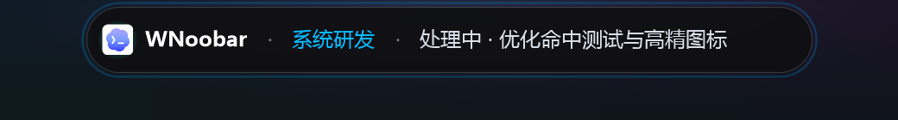
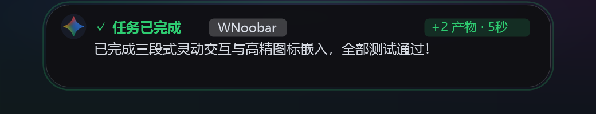
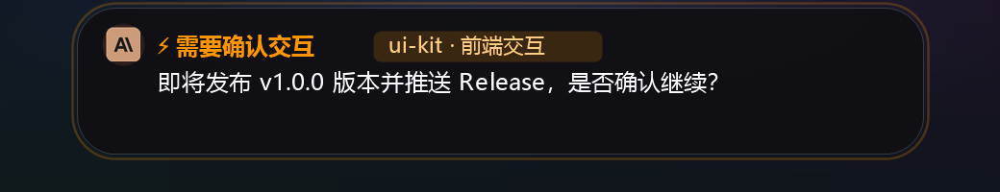
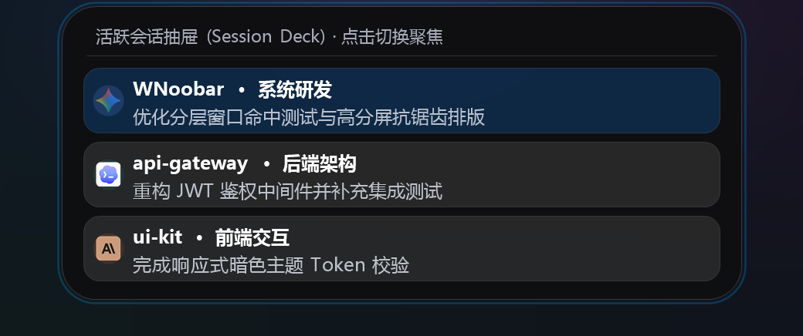

#   WNoobar (Windows AI Agent Dynamic Island)

> **Silent by default, Delightful when active.**  
> 专为 Windows 平台打造的 **AI Agent 原生灵动岛** 悬浮感知组件。

---

## 📖 项目简介

**WNoobar** 是一款纯血原生、极轻量、高性能的 Windows 桌面灵动岛交互程序。它能在屏幕顶端以优雅的胶囊与流光动画，实时感知并可视化主流 AI Agent（**Google Antigravity**、**Claude Code**、**Cursor**、**OpenAI Codex**、**DeepSeek**、**OpenCode**、**GitHub Copilot**、**xAI Grok**）的任务生命周期。

程序基于纯 Rust + Win32 原生分层窗口（Layered Window）与 GDI+ 渲染，不依赖任何重量级 GUI 框架或 Web 容器，编译产物为单一便携 `.exe` 文件，待机 CPU 占用 0.0%，后台静默常驻无任何 CMD 命令行黑框干扰。

---

## 🤖 8 大 AI Agent 深度适配矩阵

| AI Agent | 官方微标 | 专属光晕配色 | 监听链路与生命周期支持 |
| :--- | :---: | :---: | :--- |
| **Google Antigravity** | 极光四角星 | `#5AB4FF` 智蓝光环 | 监听 `~/.gemini/antigravity/brain/` 实时日志，感知任务启动、思考规划、工具调用、Action Needed 确认与 Done 交付，支持三档降噪实时热切换 |
| **Claude Code** | 珊瑚微标 | `#D97757` 赤陶橙红 | 监听 `~/.claude/projects/` 会话日志，实时捕获 `tool_use`（Bash/Edit/View）与 `end_turn` 交付 |
| **Cursor** | 暗夜微标 | `#6366F1` 赛博幻紫 | 监听 `workspaceStorage/` 与 `globalStorage/` 中的 `state.vscdb`，实时追踪 Composer 与 Chat 活跃生命周期 |
| **OpenAI Codex** | 极客墨绿 | `#10A37F` 极客墨绿 | 监听 `~/.codex/sessions/` 活跃日志，多轮任务启动、执行流与完成闭环检测 |
| **DeepSeek** | 灵动深海蓝 | `#1E6FFF` 深蓝脉冲 | 深度感知 `<think>` 思考阶段（“深度思考中...”），思考收敛后平滑过渡至交付卡片 |
| **OpenCode** | 极客双括号 | `#4F46E5` 极客靛蓝 | 监听 `~/.local/share/opencode/storage/`，自动提取项目工程、会话元数据与工具链执行 |
| **GitHub Copilot** | 幻紫智翼 | `#9333EA` 电光幻紫 | 监听 `%APPDATA%/Code/User/workspaceStorage/` 会话状态，精准捕获 Copilot Chat 生成与权限确认提示 |
| **xAI Grok** | 星环斜杠 | `#EBEBF0` 深空银白 | 监听 `~/.grok/sessions/` 会话轨迹与摘要文件，支持工具调用追踪与交付结果汇总 |

---

## 📸 效果演示

| 状态 | 预览 |
| :--- | :--- |
| **待命就绪 (Idle)**<br>日常极细贴边微光条，鼠标轻触顶部即展开就绪态胶囊 |  |
| **节拍 1 · 启动致意 (Start Pop)**<br>发起新任务时轻盈滑出致意，蓝色星环光晕提示 |  |
| **节拍 2 · 执行中 (Working)**<br>支持多 Agent 微标识别，悬浮查看实时阶段与进度摘要 |  |
| **节拍 3 · 完成交付 (Done)**<br>任务完成顺滑展开交付卡片，展示摘要、产物数与耗时 |  |
| **交互确认提醒 (Action Needed)**<br>需要用户决策或授权时亮起琥珀暖橙警示光晕 |  |
| **活跃会话抽屉 (Session Deck)**<br>点击左侧微标或托盘菜单展开多 Agent 会话聚合卡片 |  |

---

## ✨ 核心特性

### 1. 三段式节律交互 (Three-Beat Rhythm)
- **节拍 1 · 启动致意 (Start Pop)**：当用户发起新任务时，顶层灵动岛轻盈滑出展开，致意 1.8 秒后平滑微缩贴边。
- **节拍 2 · 执行静默期 (Silent In-Progress)**：后台思考与执行过程中，灵动岛保持极细微光贴边（仅 2.5px），呼吸光晕指示 Agent 正在工作，绝不弹窗挡住 IDE 敲代码。
- **节拍 3 · 完成交付 (Completion Pop)**：当任务彻底交付收官时，灵动岛顺滑延展出大卡片，展示任务成果摘要与耗时，展示 3.5 秒后自动收缩贴边归于待命。

### 2. Odometer 多会话垂直轮播 (Odometer Carousel)
- 当同时有 2 个及以上 AI 会话并发工作时，展开状态的灵动岛自动进入 **Odometer 里程表垂直轮播模式**；
- 每条会话驻留 3.2 秒后，以 600ms Cubic EaseOut 物理缓动垂直翻滚切换，并带有 220ms 落地微弹强调；
- 支持鼠标悬停在正常展开态时通过 **鼠标滚轮** 手动上下切换当前聚焦展示的并发会话。

### 3. 活跃会话抽屉 (Session Deck) 与一键窗口聚焦
- 点击灵动岛左侧品牌微标或托盘菜单，即可纵向展开「活跃会话抽屉」；
- 聚合展示近期所有 Agent 会话卡片，实时显示会话名称、工程所属、执行阶段与各 Agent 专属微标；
- **点击抽屉卡片或 Action Needed 卡片右侧「↗ 跳转窗口」**，即可智能匹配并自动拉起对应的 IDE（Antigravity / Cursor / VS Code）或终端窗口（Windows Terminal / PowerShell / WezTerm / Alacritty）至前台，灵动岛随后自动贴边避让。

### 4. v1.2.0 系统生态与降噪特性
- **配置持久化与 3 档实时降噪**：配置自动保存至 `%APPDATA%\WNoobar\config.json`；支持托盘热切换 `极简 Silent`（关闭启动轻弹、Idle 显示极简标识并静音抑制中间脉冲）、`标准 Normal`、`详细 Verbose` 三档降噪；
- **多显示器跟随与高分屏自适应**：支持 `固定主显示器` 与 `跟随鼠标所在屏幕` 两种策略，跨显示器切换或 DPI 变化时安全重建 Retina DIBSection 与 GDI+ 渲染表面；
- **全屏 / 投屏免打扰 (DND)**：通过 `SHQueryUserNotificationState` 与前台窗口覆盖检测，在全屏游戏、全屏视频或演示模式下自动静默隐藏灵动岛，退出全屏后即时恢复；
- **单实例互斥锁与二次唤醒**：内置全局命名互斥锁，重复双击 `wnoobar.exe` 时自动唤醒已运行的灵动岛并优雅退出，避免多开冲突；
- **开机自启动与轻量状态提示音**：托盘一键写入/移除 `HKCU\Software\Microsoft\Windows\CurrentVersion\Run` 自启项，并支持开启克制的系统原生提示音（仅在 `Done` / `ActionNeeded` 且非 DND 时异步播报）。

### 5. 系统状态栏托盘常驻 (System Tray)
- **无黑框后台运行**：已启用 `#![windows_subsystem = "windows"]`，完全摆脱 CMD 终端窗口；
- **鼠标左键单击 / 双击**：快速展开灵动岛或收缩为贴边隐藏；
- **鼠标右键快捷菜单**：
  - 📌 **展开/收起灵动岛**
  - 📋 **活跃会话抽屉 (Session Deck)**
  - 🎚️ **通知降噪**（极简 Silent / 标准 Normal / 详细 Verbose）
  - 🖥️ **屏幕位置**（固定主显示器 / 跟随鼠标所在屏幕）
  - 🔕 **全屏 / 投屏免打扰**
  - 🔔 **轻量状态提示音**
  - 🚀 **开机自动启动**
  - 🔄 **还原待命就绪状态**
  - ❌ **退出 WNoobar**
- **动态悬浮气泡 (Tooltip)**：随任务状态实时更新（待命就绪 / 启动 / 处理中 / 完成 / 需确认）。

---

## 🏗️ 系统架构与目录结构

```text
f:\项目\WNoobar
├── assets/                     # 嵌入式矢量与高精位图资产
│   └── icons/                  # 8 大官方 Agent 与品牌微标 PNG
├── src/
│   ├── main.rs                 # 程序入口、单实例守护与配置初始化
│   ├── core/                   # 核心业务层
│   │   ├── bus.rs              # 轻量无锁 crossbeam 事件总线 (AgentEvent)
│   │   ├── config.rs           # AppConfig 持久化与 SharedNoiseFilter 实时降噪
│   │   ├── fsm/                # 有限状态机 (IslandState, EdgeDockMode)
│   │   └── watcher/            # 8 大 AI Agent 监听驱动引擎
│   │       ├── antigravity.rs  # Google Antigravity 本地 Brain 日志监听器
│   │       ├── claude.rs       # Anthropic Claude Code 会话日志监听器
│   │       ├── codex.rs        # OpenAI Codex 会话日志管道监听器
│   │       ├── copilot.rs      # VS Code GitHub Copilot 会话监听器
│   │       ├── cursor.rs       # Cursor IDE 状态与 Composer 动向监听器
│   │       ├── deepseek.rs     # DeepSeek 推理引擎与思考流监听器
│   │       ├── grok.rs         # xAI Grok 会话日志监听器
│   │       └── opencode.rs     # OpenCode 终端智能体存储监听器
│   ├── ui/                     # 原生视觉与动效层
│   │   ├── capsule.rs          # 灵动岛视窗、卡片、抽屉绘制与命中几何
│   │   ├── glyphs.rs           # 各 Agent 图标位图与光晕特效管理器
│   │   ├── odometer.rs         # 多会话 Odometer 垂直滚轮轮播引擎
│   │   └── spring.rs           # RK4 阻尼弹簧物理动效引擎 (Spring Dynamics)
│   └── win32/                  # Win32 底层系统契约
│       ├── focus.rs            # 跨进程窗口识别打分与安全拉起聚焦
│       ├── gdiplus.rs          # GDI+ C-ABI 封装与 ClearType 抗锯齿
│       ├── system.rs           # 单实例互斥锁、开机自启、提示音、DND 与多屏 DPI
│       └── window.rs           # 穿透分层窗口、托盘菜单、交互调度与双阈值热区
├── tests/
│   └── integration_test.rs     # 系统级端到端集成测试套件
├── Cargo.toml                  # Rust 依赖与发布配置
└── wnoobar.exe                 # 最终生成的单文件便携可执行程序
```

---

## 🚀 编译与运行指南

### 前置依赖
- **Rust 工具链**：1.80+ (推荐使用 `x86_64-pc-windows-msvc` 或 `x86_64-pc-windows-gnu`)
- **构建环境**：Windows 10 (1903+) 或 Windows 11

### 本地编译
```bash
# 运行自动化测试套件
cargo test

# 生产级极速构建 (开启 LTO 与符号裁剪，生成纯单文件)
cargo build --release
```

编译出的二进制文件位于：
`target/release/wnoobar.exe`（约 800KB）。

### 启动运行
直接双击运行 `wnoobar.exe` 即可：
- 无需安装，即开即用；
- 启动后自动吸附在主显示器顶部中央，并常驻于右下角任务栏托盘；
- 支持命令行参数 `--demo` 模拟完整三段式节律交互（`wnoobar.exe --demo`）。

---

## 📄 文档索引

- **系统技术规格书**：请查阅本会话历史归档的 [`wnoobar_architecture.md`](file:///C:/Users/WYF/.gemini/antigravity/brain/780605e5-6f13-4d42-89d8-5c16274ac781/wnoobar_architecture.md) 获取详细的系统设计与架构图谱。
